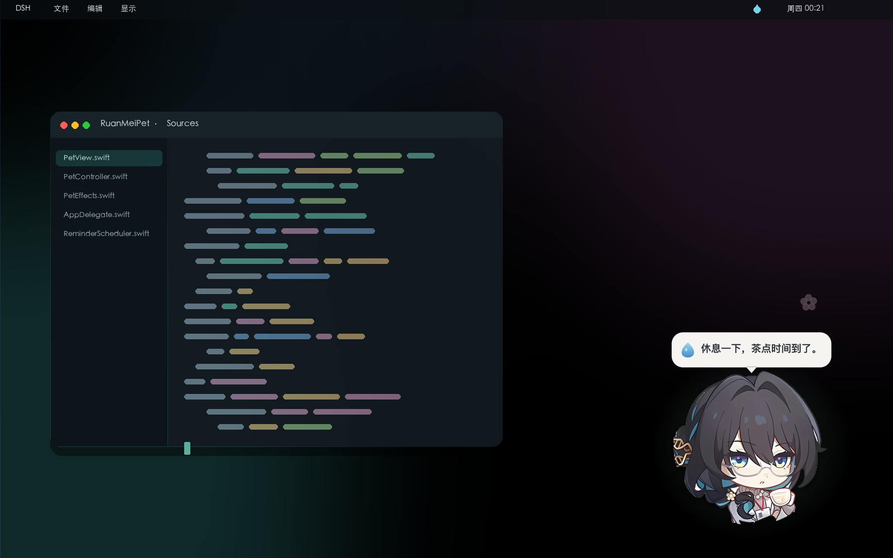
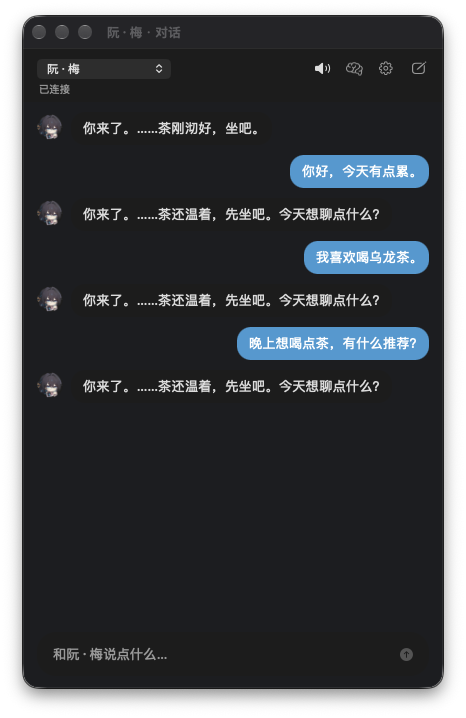

# 阮·梅桌宠 · macOS

一个常驻桌面的原生小挂件：形象来自阮·梅立绘（已去白底），会呼吸、轻轻浮动、眨眼、飘落梅花（可在菜单里开关）；可以拖到屏幕任意位置；每到整点用文字气泡 + 语音提醒你喝水。
从 v4.0 起，她还能和你说话：接入你自己的大模型 API，流式回复、人格卡、长期记忆，语音输出可以用你克隆出来的阮·梅音色。



> 这是独立的 macOS 原生应用，不是浏览器插件。浏览器/网页插件无法把内容覆盖到「所有应用」之上，只有原生窗口（`NSPanel`）才能做到。

> 本仓库已更新到 **v4.0**，包含源码、构建脚本、处理后的形象/眨眼/语音资源与预览；Releases 提供最新安装包。原始录屏和未处理立绘未随仓库提供。

## 下载

- [GitHub Releases](https://github.com/wcwww-del/ruanmei-desktop-pet/releases/latest) 下载最新的 `RuanMeiPet-*-macOS.zip`（macOS 13+，Apple Silicon）
- 解压后双击 `阮·梅桌宠.app`；首次打开如被 Gatekeeper 拦截，右键 →「打开」
- 也可以 clone 仓库后运行 `./build.sh` 自行构建

## 直接运行

从 [Releases](https://github.com/wcwww-del/ruanmei-desktop-pet/releases/latest) 下载 zip，解压后双击 `阮·梅桌宠.app`；首次打开如果被 Gatekeeper 拦下，右键 →「打开」。

本地构建后也可以：

```bash
open "dist/阮·梅桌宠.app"
```

启动后没有 Dock 图标，控制入口在**菜单栏右上角的水滴图标**，右键阮·梅也能打开同一个菜单。

## v4.0 更新（当前版本）

新增「和阮·梅说话」：接入自定义大模型 API，流式回复、人格卡、长期记忆与语音输出。



### 对话
- 菜单栏水滴 →「和阮·梅说话…」打开对话窗口；消息是左右气泡，回复逐字流式出现（OpenAI Chat Completions 协议，`stream: true`）。
- Base URL 填到 `/v1` 这一级，程序自己拼 `/chat/completions`；任何兼容服务都能用，本地 Ollama / LM Studio（`http://127.0.0.1:…`）也行。
- 回复结束时如果对话窗口不在前台，桌宠会把第一句带回自己的气泡上。
- 对话窗口关闭时不发任何请求；内存/CPU 只在说话时才有开销。

### 人格卡
- 内置三张：**阮·梅**（默认，原著向：天才俱乐部 #81、生命科学研究者，温和克制、略带疏离，称你「你」）、**阮·梅 · 实验记录**（更学术、更爱追问）、**桌面助手**（通用问答）。
- 每张卡就是一份系统 Prompt 模板，包含【性格】【语气】【称呼】【边界】【示例】；设置 →「人格」里可以新建、复制为自定义、编辑、删除，切换后下一轮立即生效。
- 内置人格只读，复制后随便改；Prompt 里写清「回复 1–3 句」能让气泡更自然。

### 记忆
- 对话、记忆卡片、对话摘要都存在本机 SQLite：`~/Library/Application Support/RuanMeiPet/pet.sqlite3`（WAL、参数化 SQL）。
- 每 N 轮（默认 6）用你配置的模型自动整理一次「关于用户的偏好 / 事实 / 计划 / 关系」；每 N 条消息（默认 12）生成一段对话提要。
- 每次发消息时按关键词检索（中文二元组 + 单字，带停用词）挑出最相关的几条记忆，**只注入相关的**，不会把全部记忆塞进上下文。
- 菜单栏 →「记忆…」可以查看、单条删除、清空全部，也可以「立即整理」；记忆功能可以整体关闭（关掉后不再额外调用模型）。

### 语音
- 对话窗口顶部有语音开关；设置里可选「系统语音（离线）」或「OpenAI 兼容 TTS」。
- 流式回复按句切分，边生成边朗读；新消息会打断上一段。
- **阮·梅的音色**：应用不内置声音克隆模型（2.5 MB 装不下）。设置 → 语音 →「导出音色样本…」会把内置的阮·梅语音拼成一段约 27 秒的参考样本；上传到支持声音克隆的 TTS 服务（SiliconFlow CosyVoice、MiniMax、ElevenLabs 等），把克隆出的 **voice ID** 填进「声音 ID」，Base URL 填该服务的 OpenAI 兼容 TTS 地址即可。不想用云服务就选系统语音，离线可用，只是音色不是她。

### 安全与隐私
- API Key（模型 / TTS 各一个）存在系统钥匙串，service 为 `com.wangchao.ruanmeipet`；磁盘上的 `config.json` 只放非敏感设置（0600）。
- 接口地址只允许 **https**；本机回环地址（`127.0.0.1` / `localhost`）允许 http，方便本地模型。
- 对话内容只发送给你配置的接口，不经过任何中转；记忆与对话只存在本机，没有遥测。
- 数据库全部参数化 SQL；消息、记忆、输入长度都有上限；提示词里的记忆块会被当作数据处理。

## v3.6 更新

这一版只做两件事：**把能耗降下来，把安全补上去**。

### 能耗：活动监视器里从「几十 %」回到「约 0%」

- 渲染方式整个换掉：不再每 1/60 秒重绘一次整块视图，而是启动时把形象、投影、光环、眼睛叠加层、花瓣、气泡一次性烘焙成位图，之后交给 Core Animation 合成。呼吸、浮动、摇摆、光环脉动都是 GPU 上的循环动画，空闲时主线程完全休眠（不再有 60Hz 主循环，也不再每帧重建渐变和贝塞尔路径）。
- 眨眼、飘花、星光改成单次定时器；花瓣和星光的运动轨迹在生成时一次算完，播放同样交给 CA。
- 整点提醒不再每秒对时，而是只在下一个整点挂一个单次 Timer。
- 鼠标穿透检测从固定 30Hz 改成按距离分级：指针压在宠物身上时交给窗口事件，远处 1Hz、中距 6Hz、近处 20Hz。
- 窗口被遮挡、屏幕休眠、选择「隐藏桌宠」时自动暂停动画与定时器；双显卡机型优先使用集成显卡。
- 新增「低耗电模式（静止）」：停掉呼吸 / 摇摆 / 花瓣，只保留静帧与眨眼。

实测（230pt、梅花飘落开启）：进程 CPU 从 **27–48%** 降到 **0.0–0.1%**（15 秒内累计 CPU 时间 0.02 秒），空闲唤醒从约 90 次/秒降到 1–2 次/秒。

### 安全

- **Hardened Runtime 签名**：`build.sh` 现在用 `--options runtime` 加最小化的 `Entitlements.plist` 签名，并当场校验签名。
- **素材白名单式校验**：自定义形象 / 语音只有在「属于当前用户、不是符号链接、组和其他人不可写、体积与像素尺寸不超上限」时才会被加载；图片交给 ImageIO 判断真实格式（最大 4096×4096、1600 万像素），语音只接受 ISO-BMFF 容器并整段读入内存。
- **不再从工作目录加载素材**：旧版本会尝试读 `./assets`，从不可信目录启动时可能加载到别人的素材；现在只认 App 包内资源或 `~/Library/Application Support/RuanMeiPet`，开发调试需显式设置 `RUANMEI_DEV_ASSETS=1`。
- **单实例**：`LSMultipleInstancesProhibited`，避免两只桌宠抢位置、重复提醒、能耗翻倍。
- **资源上限**：同屏粒子最多 96 个、单次爆发最多 24 个；气泡文案最长 400 字、显示时长 0.6–120 秒，不会因为异常输入无限膨胀。
- **崩溃面收敛**：去掉强制解包，校验保存的位置字符串（NaN / Inf / 超大值回退到默认位置），退出时失效全部定时器，通知观察者成对注销。
- 被拒绝的自定义素材会在启动几秒后用气泡提示，而不是静默失败。

### 说明

- 没有开启 App Sandbox：开启后 `~/Library/Application Support/RuanMeiPet` 会迁移到容器目录，现有的「放一张 PNG 换形象」用法会失效。当前用 Hardened Runtime + 素材校验替代。

## v3.5 更新

- 新增「梅花飘落」开关（菜单栏水滴 →「梅花飘落」，右键菜单同）。
- 关闭后立即清掉还在飘的梅花，之后不再生成；重新打开约半秒后恢复飘落。
- 开关状态会记住，重启应用后保持上次的选择。

## v3.4 更新

- 菜单顶部标题从「阮·梅 · 桌宠」改为「阮·梅桌宠」。
- 删除「试听喝水语音」菜单项。
- 新增全局「语音」开关：关闭后所有语音（喝水、打招呼、移动、点击 1/2/3）静音，但气泡仍然显示；重新打开即恢复。开关状态会记住。

## v3.3 更新

- **移动结束语音**：拖动阮·梅松手后，气泡显示「很好，优美的姿势。」并播放 `ruanmei_move.m4a`。
- **点击分级语音**：
  - 单击一次 →「那是什么？有点…感兴趣。」（点击语音包 1）
  - 1 秒内连点 2 次 →「有趣吗？」（点击语音包 2）
  - 1 秒内连点 3 次及以上 →「离我远点。」（点击语音包 3）
- 气泡与对应语音完全一致；移动、点击、打招呼、整点提醒的语音互斥，开始播放一个会停掉前一个。
- 新增 4 条音轨：`ruanmei_move.m4a`、`ruanmei_click1/2/3.m4a`。

## v3.2 更新

- 整点喝水气泡固定为与语音完全一致的「休息一下，茶点时间到了。」；菜单「现在提醒我喝水」也使用同一句。
- 打招呼语音保持 v3.1 的行为，不受影响。

## v3.1 更新

- **新增「打招呼」语音**：从 `阮·梅打招呼语音包.MP4`（6.87 秒）提取 `assets/ruanmei_greet.m4a`（6.85 秒）。
- 菜单栏 →「打个招呼」：播放这段语音，气泡同步显示「我叫阮·梅，念我名字时，请别忘了中间气息的停歇。」
- 打招呼语音与整点喝水语音互斥：开始播放其中一个时，会先停掉另一个。

## v3.0 更新

按反馈做了减法：

- **只保留眨眼**：约 0.2 秒一次，随机 3–6.8 秒触发，偶尔连眨两下。推眼镜、发丝飘动、喝水动作及对应的手部/水杯/发丝序列全部移除。
- **重新提取语音**：从新版 `阮·梅语音包.MP4`（3.99 秒）重新提取，覆盖了原来的 `assets/ruanmei_voice.m4a`（3.98 秒）。整点提醒时气泡 + 语音一起出现。
- 保留 v1 的呼吸、浮动、摇摆、点击弹跳、花瓣/星光/水滴粒子，以及 230 pt 的小尺寸。
- App 体积从 v2 的 12 MB 回到约 **2.3 MB**。

## 怎么玩

| 操作 | 效果 |
| --- | --- |
| 按住她拖动 | 随意移动；松手后位置会被记住，并说「很好，优美的姿势。」 |
| 单击 | 说「那是什么？有点…感兴趣。」（点击语音 1） |
| 1 秒内连点 2 次 | 说「有趣吗？」（点击语音 2） |
| 1 秒内连点 3 次及以上 | 说「离我远点。」（点击语音 3） |
| 右键 | 打开菜单 |
| 点击气泡 | 关闭气泡 |
| 菜单栏水滴 →「和阮·梅说话…」 | 打开对话窗口 |
| 菜单栏水滴 →「记忆…」 | 查看 / 删除记忆 |
| 菜单栏水滴 →「设置…」 | 模型 API、语音、记忆、人格 |
| 菜单栏水滴 | 大小 / 整点提醒 / 夜间免打扰 / 语音（总开关） / 梅花飘落 / 低耗电模式 / 始终置顶 / 隐藏 / 重置位置 / 退出 |

透明区域不会拦截鼠标，不会挡住下面窗口的点击。

## 和阮·梅说话（首次配置）

1. 菜单栏水滴 →「设置…」→「模型」：填 Base URL（例如 `https://api.deepseek.com/v1`）、API Key、模型名（例如 `deepseek-chat`），点「测试连接」。
2. 菜单栏水滴 →「和阮·梅说话…」，在输入框里说话，回车发送；「⋯」里的停止按钮可以随时打断。
3. 想要她的音色：设置 →「语音」→「导出音色样本…」，把样本上传到支持声音克隆的 TTS 服务，克隆出的 voice ID 填回「声音 ID」，再点「试听」。
4. 想要她记住你：保持「记忆」开启；在「记忆…」窗口里可以看、可以删。不想让她记就整体关掉。

> 对话内容会发送给你自己配置的模型服务；本应用不内置任何模型，也不收集数据。

## 整点喝水提醒

- `ReminderScheduler` 每秒对时，`xx:00` 触发，按「年-月-日-时」去重。
- 提醒 = 文字气泡 + 跳一下 + 水滴粒子 + **语音**。
- 气泡固定为与语音一致的「休息一下，茶点时间到了。」。
- 菜单可关闭提醒；可开启 **23:00–07:00 夜间免打扰**。
- 语音提取命令（需要本地原始 MP4 素材；本仓库只包含提取后的 m4a）：

```bash
afconvert -f m4af -d aac -b 128000 "阮·梅语音包.MP4" assets/ruanmei_voice.m4a
afconvert -f m4af -d aac -b 128000 "阮·梅打招呼语音包.MP4" assets/ruanmei_greet.m4a
afconvert -f m4af -d aac -b 128000 "阮·梅移动语音包.MP4" assets/ruanmei_move.m4a
afconvert -f m4af -d aac -b 128000 "阮·梅点击语音包1.MP4" assets/ruanmei_click1.m4a
afconvert -f m4af -d aac -b 128000 "阮·梅点击语音包2.MP4" assets/ruanmei_click2.m4a
afconvert -f m4af -d aac -b 128000 "阮·梅点击语音包3.MP4" assets/ruanmei_click3.m4a
```

喝水语音内容是「休息一下，茶点时间到了。」，整点气泡也使用完全相同的这句话。打招呼语音内容是「我叫阮·梅，念我名字时，请别忘了中间气息的停歇。」，点击「打个招呼」时气泡显示同一句。

想换语音，替换 `assets/` 下对应的 `.m4a` 后重新构建，或放到 `~/Library/Application Support/RuanMeiPet/` 覆盖。菜单栏 →「语音」可以一键开关所有声音；打招呼语音直接点「打个招呼」。

## 换成别的形象

优先级从高到低：

1. `~/Library/Application Support/RuanMeiPet/ruanmei.png`
2. App 包内 `Contents/Resources/ruanmei.png`
3. 源码目录 `assets/ruanmei.png`

放一张**透明底、正方形 PNG**，重启应用即可。非正方形会按比例适配，但眨眼叠加层是按这张图设计的，换图后位置可能对不上。

重新处理原始图（需要未处理的 `阮·梅.png`，未随仓库提供）：

```bash
python3 tools/process_assets.py     # 去白底、裁切、应用图标
python3 tools/make_effects.py       # 眨眼叠加层、柔和投影
./build.sh
```

## 构建

```bash
./build.sh
```

- 需要 Xcode Command Line Tools（`swiftc`、`iconutil`）
- 目标：macOS 13+，当前为 Apple Silicon（arm64）
- 签名：ad-hoc + **Hardened Runtime**（`codesign --options runtime --entitlements Entitlements.plist`），权限清单为空；构建脚本会 `codesign --verify --strict` 自检
- 只在本机使用；拷到别的 Mac 如被拦截，右键 →「打开」

## 目录结构

```
assets/ruanmei.png            去白底后的 900×900 形象（运行所需）
assets/fx_blink_half.png      半闭眼叠加层
assets/fx_blink_closed.png    闭眼叠加层
assets/fx_shadow.png          柔和投影
assets/ruanmei_voice.m4a      喝水提醒语音（3.98s）
assets/ruanmei_greet.m4a      打招呼语音（6.85s）
assets/ruanmei_move.m4a       移动结束语音（3.80s）
assets/ruanmei_click1.m4a     点击语音 1（5.21s）
assets/ruanmei_click2.m4a     点击语音 2（3.23s）
assets/ruanmei_click3.m4a     点击语音 3（2.75s）
Sources/                      原生 AppKit 源码
  ChatWindowController.swift  对话窗口与流式编排
  ChatViews.swift             气泡 / 对话记录 / 头部
  ChatInputView.swift         输入条
  ChatClient.swift            OpenAI 兼容流式客户端
  ChatStore.swift             SQLite：消息 / 记忆 / 摘要
  MemoryEngine.swift          记忆检索与整理提示词
  SpeechEngine.swift          TTS 队列 + 音色样本导出
  SettingsWindowController.swift 设置窗口（模型 / 语音 / 记忆 / 人格）
  MemoryWindowController.swift   记忆查看 / 删除
  AppConfig.swift             配置、钥匙串、接口白名单
  Persona.swift               内置人格卡
  PetView.swift               Core Animation 图层、眨眼、粒子、气泡、拖拽
  PetImages.swift             启动时把各图层烘焙成位图
  PetEffects.swift            形象与眨眼/阴影资源加载（带安全校验）
  Security.swift              素材 / 文本 / 坐标 / 限额校验
  PetController.swift         窗口、菜单栏、提醒、位置记忆、语音
  PetPanel.swift              透明置顶面板
  ReminderScheduler.swift     整点单次定时调度
  Support.swift / Snapshot.swift
tools/                        资产生成脚本
dist/                         本地构建产物（不随仓库提交）
docs/preview.png              效果预览（真实运行截图合成）
docs/chat.png                 对话窗口预览
config.json / pet.sqlite3     运行时配置与数据库（在 ~/Library/Application Support/RuanMeiPet）
```

> 原始立绘与游戏录屏未包含在仓库中；`assets/` 里是运行所需的成品图片、眨眼图层和提取后的语音。

## 版本

- `v1.0`：置顶、拖拽、整点喝水气泡、基础动效。
- `v2.0`：眨眼、发丝飘动、推眼镜、喝水动作、整点语音、尺寸缩小到 230。
- `v3.0`：按反馈移除推眼镜/发丝/喝水，只保留眨眼；重新提取语音；体积回到 2.3 MB。
- `v3.1`：新增「打个招呼」语音（初次见面），气泡与语音同步。
- `v3.2`：整点喝水气泡改为与语音完全一致的「休息一下，茶点时间到了。」。
- `v3.3`：移动结束语音 + 点击 1/2/3 分级语音，气泡与语音一致。
- `v3.4`：菜单标题改为「阮·梅桌宠」；删除试听项；新增全局语音开关。
- `v3.5`：新增「梅花飘落」开关，状态记忆。
- `v3.6`：渲染改为 Core Animation 合成，空闲 CPU 从约 27–48% 降到约 0.1%；新增「低耗电模式」；Hardened Runtime 签名、素材安全校验与单实例保护。
- `v4.0`：接入自定义大模型 API（流式对话、人格卡、长期记忆与检索、TTS 语音输出）；API Key 存钥匙串；本地 SQLite 存对话 / 记忆 / 摘要。

## 已知边界

- 对话需要联网并配置模型 API；没有 Key 时打开对话窗口会提示去设置
- 阮·梅音色需要第三方声音克隆服务：应用只负责导出参考样本，不内置克隆模型
- 自动整理记忆和生成摘要会额外消耗 token（可关闭 / 调整频率）
- 重建应用后 ad-hoc 签名变化，钥匙串里的 API Key 可能需要重新填写
- 未开启 App Sandbox（见 v3.6 说明）；素材读取范围靠白名单校验约束
- 自定义形象必须是当前用户拥有、组/其他人不可写的普通文件，否则会被拒绝并提示
- 锁屏/登录窗口之上不会显示（系统安全限制）
- 通知气泡由应用自身绘制，不经过通知中心；不需要通知权限
- 整点提示在系统睡眠期间不会补发；唤醒后从下一个整点继续
- 应用不常驻 Dock，退出请用菜单栏 →「退出阮·梅」
- 形象与语音版权归 miHoYo / HoYoverse，仅作个人桌面装饰使用
